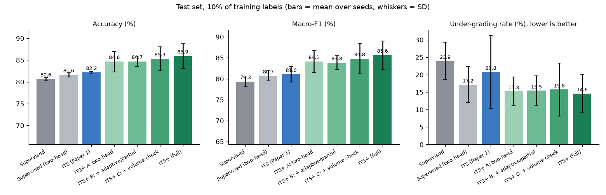
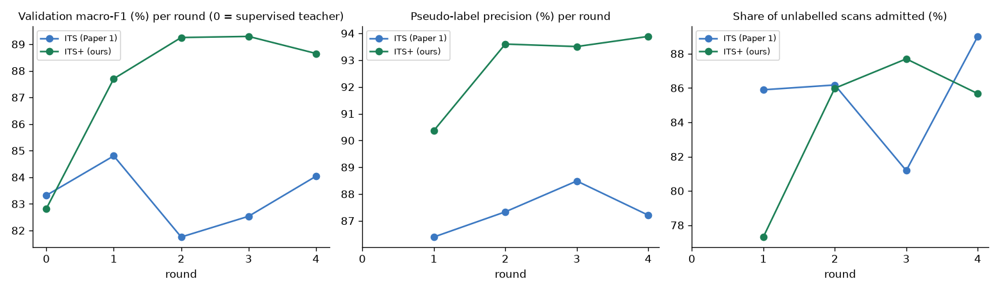

# Hierarchical Teacher–Student Pseudo-Labelling for Semi-Supervised Retinal OCT Classification

Classifies retinal OCT B-scans as **NORMAL**, **DRUSEN** or **CNV** using only **10% of the training labels**.
The method extends iterative teacher–student pseudo-labelling [1] with a hierarchical classifier, class-adaptive
partial-label admission and volume-context agreement [2], plus a pseudo-label loss ramp-up and final fine-tuning [3].

**Full comparison of every model, seed and component: [COMPARISON.md](COMPARISON.md). What every file does and where each part of the method is in the code: [CODE_GUIDE.md](CODE_GUIDE.md).**

## Results

Test set: 4,326 B-scans from 109 cases not used for training or model selection. Mean ± SD over 3 seeds, in %.

| Model | Accuracy | Macro-F1 | Macro-AUC | Under-grading rate ↓ |
|---|---|---|---|---|
| Supervised (labelled 10% only) | 80.64 ± 0.39 | 79.31 ± 1.14 | 91.29 ± 0.58 | 23.94 ± 5.35 |
| Iterative Teacher–Student (ITS) [1] | 82.15 ± 0.18 | 81.03 ± 1.86 | 93.53 ± 0.54 | 20.84 ± 10.42 |
| **Ours (ITS+)** | **85.90 ± 2.84** | **85.64 ± 3.37** | **94.79 ± 1.59** | **14.64 ± 5.33** |

Under-grading rate = share of diseased scans predicted NORMAL. ITS+ is ahead of ITS on all three seeds
(+6.63, +3.81, +0.79 accuracy points).



### Ablation

| Configuration | Accuracy | Change |
|---|---|---|
| ITS [1] | 82.15 | |
| + hierarchical classifier | 84.64 | +2.49 |
| + class-adaptive thresholds, partial labels | 84.67 | +0.03 |
| + volume-context agreement | 85.27 | +0.59 |
| + weak/strong augmentation, loss ramp-up, fine-tuning (full ITS+) | 85.90 | +0.63 |

Most of the gain comes from the hierarchical classifier. The later components add about 1.3 points together,
which is within the seed-to-seed spread.

## Method

**Base loop: Iterative Teacher–Student [1]**
1. Train a teacher on the labelled scans.
2. The teacher pseudo-labels the unlabelled pool.
3. A new student trains on labelled + pseudo-labelled scans.
4. The student becomes the next teacher. Repeat for 4 rounds and keep the best round on validation.

**Additions**

| Component | What it does | Source |
|---|---|---|
| Hierarchical classifier | EfficientNet-B0 with a normal/abnormal head and a drusen/CNV head, multiplied into 3 class probabilities | [2] |
| Class-adaptive thresholds | Per-class confidence thresholds in [0.90, 0.98], set from how confident the teacher is on each class | [2] (its class-adaptive baseline) |
| Three-outcome admission | Each pseudo-label is full, partial ("abnormal, type unknown") or rejected; partial labels train only the normal/abnormal head | [2] |
| Volume-context agreement | A pseudo-label must agree with the mean prediction over 5 neighbouring B-scans of the same volume | [2], simplified |
| Weak/strong augmentation | Labelled scans lightly augmented, pseudo-labelled scans strongly augmented with Cutout | [2] |
| Pseudo-label loss ramp-up | Pseudo-label loss weight rises from 0 to 1 over the early epochs | [3] |
| Fine-tuning | Short final fine-tune on true labels at a low learning rate, kept only if validation improves | [3] |



## Dataset

**NEH_UT_2021** (Noor Eye Hospital): 16,822 B-scans from 441 cases and 554 volumes, 3 classes, labelled per B-scan.
Splits are case-level, so no patient appears in more than one set.

| Split | Cases | B-scans |
|---|---|---|
| Train | 259 | 9,873 (10% labelled: 940) |
| Validation | 66 | 2,396 |
| Test | 109 | 4,326 |

The image file `data/images.npy` (16,803 × 224 × 224 uint8 grayscale, 805 MB) is **not included** because of its
size. Build it from the public NEH_UT_2021 release with the row order of `data/index.csv`. The metadata, splits
and labelled subsets are included in `data/` and `outputs/`.

## Usage

```bash
pip install torch torchvision scikit-learn scipy pandas matplotlib pyyaml nbformat nbconvert ipykernel
```

```bash
python run_all.py                           # main experiment: 10% labels, seed 0
```

```bash
python run_all.py --seeds 0 1 2 --ablation  # all seeds and ablation variants
```

```bash
python demo.py --seed 0                     # load trained models and print test results
```

Finished runs are skipped, so `run_all.py` can be restarted after an interruption. Trained models are in
`outputs/runs/<run>/best.pt`; ImageNet weights are downloaded automatically on first use.

## Repository structure

| Path | Purpose |
|---|---|
| `config.yaml` | Paths and hyper-parameters |
| `common.py`, `ssl_core.py` | Data, augmentation, network, training, pseudo-labelling, teacher–student loop |
| `01_data_audit.py` – `03_data_check.py` | Data checks and case-level splits |
| `04_supervised.py` | Supervised baseline |
| `05_its_faithful.py` | ITS as published [1] |
| `06_its_plus.py` | Our method (`--variant A/B/C/D`; D = full ITS+) |
| `07_evaluate.py`, `08_report.py`, `09_make_notebook.py` | Test evaluation, report, executed notebook |
| `10_unsupervised.py` | Unsupervised reference: k-means on ImageNet features |
| `11_comparison.py` | Builds `COMPARISON.md` |
| `demo.py` | Terminal demo |
| `run_all.py` | Full pipeline |
| `RESULTS.md`, `COMPARISON.md`, `results.ipynb` | Results, full comparison, executed notebook |
| `CODE_GUIDE.md` | What every file and function does, with line links |
| `outputs/runs/<run>/` | Trained model, training log, per-epoch history, per-round pseudo-label statistics |

## Differences from the original papers

- 30 epochs with early stopping (patience 8) instead of 100 (patience 15), for all models.
- Volume-context agreement uses a 5-scan probability average, not the Transformer teacher of [2].
- Strong augmentation is a GPU RandAugment-style implementation.
- The conformal risk controller of [2] is not implemented.
- Evaluation is scan-level only.

Trained on an NVIDIA RTX 3050 (4 GB) with mixed precision: about 1 minute per epoch, 1–1.5 hours per teacher–student run.

## References

1. A. Alizadeh, A. Alenezi, N. Khakestari, Y. Amizadeh, A. Jodeiri. Investigating the Impact of Semi-Supervised Learning Methods to Improve the Quality of Diagnosis of Retinal Diseases from OCT Images. *Diagnostics* 16 (2026) 656.
2. M. A. H. Akash, S. Afroge, A. Al Mamun, M. K. Morol, T. H. Liew. TRIAGE: Risk-Controlled Pseudo-Label Admission for Annotation-Efficient Semi-Supervised Retinal OCT Classification. arXiv:2608.14321 (2026).
3. Z. Tan, Q. Zhang, G. Lan, J. Xu, C. Ou, L. An, J. Qin, Y. Huang. OCT Retinopathy Classification via a Semi-Supervised Pseudo-Label Sub-Domain Adaptation and Fine-Tuning Method. *Mathematics* 12 (2024) 347.

## Supervised vs unsupervised vs semi-supervised

Same test set for every row (mean ± SD, %). The unsupervised model uses no training labels: ImageNet EfficientNet-B0
features, PCA to 50 dimensions and k-means with 3 clusters; validation labels only name the clusters.

| Learning type | Model | Labelled scans | Accuracy | Macro-F1 | Macro-AUC | Under-grading rate ↓ |
|---|---|---|---|---|---|---|
| Unsupervised | k-means on ImageNet features | 0 | 50.62 ± 0.01 | 49.27 ± 0.03 | 69.41 ± 0.01 | 24.98 ± 0.10 |
| Supervised | EfficientNet-B0, flat head | 940 | 80.64 ± 0.39 | 79.31 ± 1.14 | 91.29 ± 0.58 | 23.94 ± 5.35 |
| Supervised | EfficientNet-B0, hierarchical heads | 940 | 81.61 ± 0.45 | 80.68 ± 1.17 | 92.20 ± 1.24 | 17.16 ± 5.14 |
| Semi-supervised | ITS [1] | 940 + pseudo-labels | 82.15 ± 0.18 | 81.03 ± 1.86 | 93.53 ± 0.54 | 20.84 ± 10.42 |
| **Semi-supervised** | **ITS+ (ours)** | 940 + pseudo-labels | **85.90 ± 2.84** | **85.64 ± 3.37** | **94.79 ± 1.59** | **14.64 ± 5.33** |
