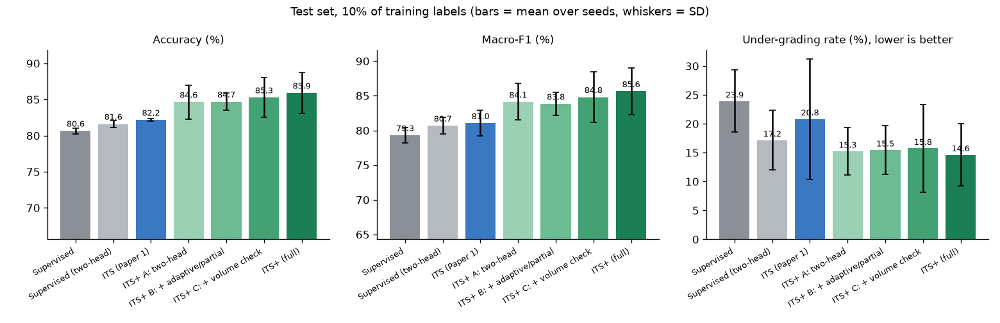
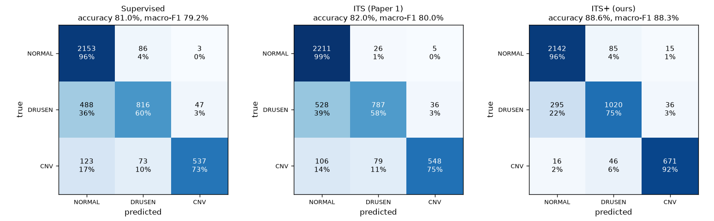
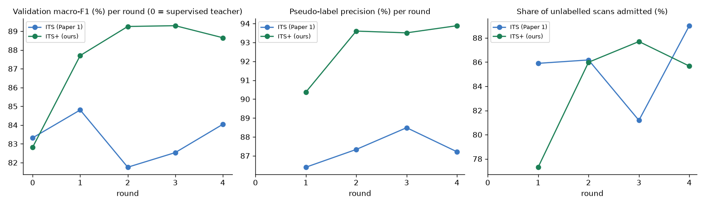

# Results

Dataset: NEH_UT_2021 (Noor Eye Hospital), 3 classes. Test set: 4,326 scans from 109 cases that no model saw during training or model selection. All numbers are scan-level, in %.

Generated by `08_report.py` from `outputs/results.csv`.

## 10% of training labels

| Method | Seeds | Accuracy | Macro-F1 | Macro-AUC | Under-grading rate |
|---|---|---|---|---|---|
| Supervised | 3 | 80.64 +/- 0.39 | 79.31 +/- 1.14 | 91.29 +/- 0.58 | 23.94 +/- 5.35 |
| Supervised (two-head) | 3 | 81.61 +/- 0.45 | 80.68 +/- 1.17 | 92.20 +/- 1.24 | 17.16 +/- 5.14 |
| ITS (Paper 1) | 3 | 82.15 +/- 0.18 | 81.03 +/- 1.86 | 93.53 +/- 0.54 | 20.84 +/- 10.42 |
| ITS+ A: two-head | 3 | 84.64 +/- 2.37 | 84.12 +/- 2.63 | 94.20 +/- 1.76 | 15.26 +/- 4.07 |
| ITS+ B: + adaptive/partial | 3 | 84.67 +/- 1.20 | 83.83 +/- 1.65 | 94.15 +/- 1.29 | 15.47 +/- 4.23 |
| ITS+ C: + volume check | 3 | 85.27 +/- 2.75 | 84.81 +/- 3.62 | 94.68 +/- 1.74 | 15.75 +/- 7.63 |
| ITS+ (full) | 3 | 85.90 +/- 2.84 | 85.64 +/- 3.37 | 94.79 +/- 1.59 | 14.64 +/- 5.33 |

Values are mean +/- SD over seeds where more than one seed was run. Under-grading rate = share of diseased scans predicted NORMAL (lower is better).

## Per-run results with 95% confidence intervals (cases resampled)

| Method | Labels | Seed | Best round | Accuracy [95% CI] | Macro-F1 [95% CI] |
|---|---|---|---|---|---|
| Supervised | 10% | 0 | 0 | 81.04 [76.7-84.8] | 79.18 [75.4-82.5] |
| Supervised | 10% | 1 | 0 | 80.63 [77.2-83.8] | 80.50 [77.2-83.3] |
| Supervised | 10% | 2 | 0 | 80.26 [75.6-84.5] | 78.24 [73.3-82.2] |
| Supervised (two-head) | 10% | 0 | 0 | 82.11 [78.4-85.5] | 81.97 [78.6-84.7] |
| Supervised (two-head) | 10% | 1 | 0 | 81.23 [77.9-84.3] | 80.40 [76.9-83.2] |
| Supervised (two-head) | 10% | 2 | 0 | 81.48 [76.9-85.7] | 79.68 [75.2-83.5] |
| ITS (Paper 1) | 10% | 0 | 1 | 81.97 [77.4-85.8] | 80.00 [76.0-83.4] |
| ITS (Paper 1) | 10% | 1 | 2 | 82.34 [78.2-86.1] | 83.18 [79.5-86.5] |
| ITS (Paper 1) | 10% | 2 | 4 | 82.15 [77.9-86.1] | 79.92 [75.4-83.8] |
| ITS+ A: two-head | 10% | 0 | 1 | 85.46 [82.2-88.5] | 84.77 [82.0-87.3] |
| ITS+ A: two-head | 10% | 1 | 3 | 86.50 [83.6-89.1] | 86.36 [83.5-88.7] |
| ITS+ A: two-head | 10% | 2 | 4 | 81.97 [77.9-85.5] | 81.22 [77.1-84.8] |
| ITS+ B: + adaptive/partial | 10% | 0 | 1 | 85.16 [81.6-88.4] | 84.61 [81.5-87.3] |
| ITS+ B: + adaptive/partial | 10% | 1 | 3 | 85.55 [82.3-88.5] | 84.95 [81.6-87.6] |
| ITS+ B: + adaptive/partial | 10% | 2 | 3 | 83.31 [79.6-86.9] | 81.93 [78.2-85.0] |
| ITS+ C: + volume check | 10% | 0 | 4 | 87.73 [84.7-90.6] | 87.71 [84.8-90.3] |
| ITS+ C: + volume check | 10% | 1 | 4 | 85.78 [82.9-88.5] | 85.95 [83.2-88.3] |
| ITS+ C: + volume check | 10% | 2 | 1 | 82.29 [77.7-86.3] | 80.76 [76.3-84.5] |
| ITS+ (full) | 10% | 0 | 3 | 88.60 [85.6-91.3] | 88.34 [85.5-90.7] |
| ITS+ (full) | 10% | 1 | 4 | 86.15 [83.1-89.0] | 86.72 [83.7-89.3] |
| ITS+ (full) | 10% | 2 | 3+fine-tune | 82.94 [78.5-87.0] | 81.86 [77.7-85.5] |

## Figures

## Published accuracy on the same dataset (for context only)

| Labels | Supervised (Paper 1) | ITS (Paper 1) | Supervised (Paper 2) | TRIAGE (Paper 2) |
|---|---|---|---|---|
| 5% | 54.78 | 64.15 | 60.28 | 76.88 |
| 20% | 77.05 | 88.56 | 79.25 | 89.66 |
| 100% | 87.14 | - | 88.50 | - |

The papers use different train/test splits and Paper 2 groups patients differently, so these are not directly comparable with the numbers above. No paper reports a 10% result.
